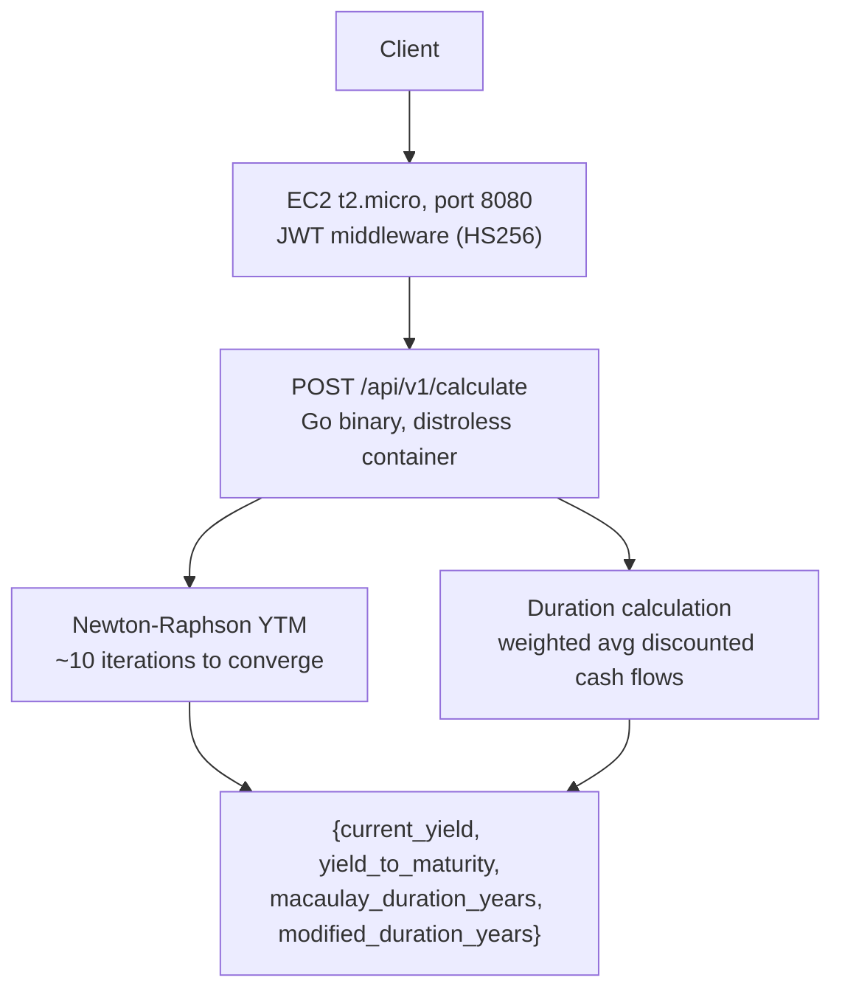

# bondcalc


REST API that computes fixed-income metrics for any bond: yield to maturity via Newton-Raphson, Macaulay and modified duration, and current yield. Written in Go, running on a single EC2 instance behind Caddy. [Health](https://52-22-210-61.sslip.io/health) answers a browser over HTTPS, and `POST https://52-22-210-61.sslip.io/api/v1/demo/calculate` runs the real computation with no token, capped at 30 requests a minute per caller. `/api/v1/calculate` is the same math behind a bearer token, for a client that has one.

Deploy via Terraform to EC2 (see `infra/`). No ALB and no NAT Gateway: Caddy terminates TLS on the instance itself and reverse-proxies to the Go binary on loopback, so HTTPS costs nothing beyond the instance already running. Spin up locally with `docker compose up`.

## Problem

Bond pricing math is deceptively subtle: YTM has no closed-form solution for most payment schedules, and duration calculations require discounting each cash flow at the solved yield. Finance teams often rely on Excel's YIELD and DURATION functions without understanding the numerical method underneath.

## Solution

A pure-computation Go service. No database, no external dependencies at runtime. YTM solves via Newton-Raphson (converges in ~10 iterations for typical bonds). Duration computes the weighted average time to each discounted cash flow, normalized to years regardless of payment frequency.

## Architecture



TLS terminates on the instance. Caddy runs with `--network host`, binds 80 and 443, and reverse-proxies to the Go binary on `127.0.0.1:8080`, so no ALB and no ACM certificate are involved. The hostname is `52-22-210-61.sslip.io`: sslip.io resolves any IP embedded in the name, which gives Caddy something real to get a Let's Encrypt certificate for without waiting on a DNS record. Moving to a vanity subdomain is one line in the Caddyfile plus an A record.

Two constraints that come with that arrangement. Every proxied request reaches the Go process from `127.0.0.1`, which is exactly what `internal/api/routes.go` pins `TrustedProxies` to, so widening one without the other breaks the demo rate limiter. And there is no ACME email configured, so Let's Encrypt cannot send expiry warnings; Caddy renews on its own, and adding an `email` directive in a global block turns the warnings back on.

## Tech Stack

| Layer | Technology | Why |
|---|---|---|
| Language | Go 1.23 | Statically compiled binary, ~10MB distroless container, no runtime overhead |
| HTTP | Gin 1.10 | Minimal middleware surface, well-understood performance profile |
| Auth | golang-jwt/jwt v5 | HS256 shared-secret JWT, validated in a single middleware layer |
| Build | Multi-stage Dockerfile | Builder stage compiles; distroless scratch stage ships only the binary |
| Infrastructure | AWS EC2 t2.micro | Free-tier eligible for 12 months; OIDC-based keyless deploys via GitHub Actions + SSM |
| IaC | Terraform 1.9 | GitHub OIDC role, ECR lifecycle policy, S3 remote state |

## Getting Started

```bash
cp .env.example .env
# set JWT_SECRET in .env

go mod tidy
go run ./cmd/server
```

Generate a test JWT (requires Go playground or jwt.io with algorithm HS256):

```json
{
  "sub": "test",
  "exp": 9999999999
}
```

Against the live instance, no token needed:

```bash
curl -X POST https://52-22-210-61.sslip.io/api/v1/demo/calculate \
  -H "Content-Type: application/json" \
  -d '{
    "face_value": 1000,
    "annual_coupon_rate": 0.05,
    "coupons_per_year": 2,
    "periods_remaining": 20,
    "price": 950
  }'
```

The authenticated route takes the same body. Sign a token with your `JWT_SECRET`, then:

```bash
curl -X POST http://localhost:8080/api/v1/calculate \
  -H "Authorization: Bearer <your-token>" \
  -H "Content-Type: application/json" \
  -d '{
    "face_value": 1000,
    "annual_coupon_rate": 0.05,
    "coupons_per_year": 2,
    "periods_remaining": 20,
    "price": 950
  }'
```

Response:

```json
{
  "current_yield": 0.052632,
  "yield_to_maturity": 0.056617,
  "macaulay_duration_years": 7.9273,
  "modified_duration_years": 7.709,
  "coupon_payment": 25
}
```

## Running Tests

```bash
go test -v -race ./...
```

33 tests covering: at-par bonds, discount bonds, premium bonds, zero-coupon bonds, all validation error paths, the relationship invariants (YTM < coupon on premium, Macaulay > Modified), and the demo route's limiter: per-caller isolation, slots returning as they age out, a spoofed `X-Forwarded-For` from an untrusted peer failing to buy a fresh budget, a forwarded address getting its own bucket from both loopback and the docker bridge, which is what the deployed proxy actually presents and what kept every HTTPS visitor in one bucket until it was measured, and idle keys being swept so the window map stays bounded.

## Deploy

See [infra/README.md](infra/README.md) for the full Terraform + EC2 deploy runbook.

Required GitHub secrets: `AWS_ROLE_ARN`, `ECR_API_REPO`, `EC2_INSTANCE_ID`, `PRODUCTION_URL`. The JWT signing secret lives in SSM Parameter Store, not in a GitHub secret; the instance reads it directly at container start.

## Known Limitations

- YTM solver assumes non-negative periodic yield; deeply distressed bonds (price near zero) may not converge within 200 iterations.
- Semi-annual convention assumed for all duration math when `coupons_per_year = 2`; quarterly and monthly bonds use the same formula with the appropriate period length.
- JWT is HS256 shared-secret: acceptable for a single-service API, not suitable if multiple independent services need to verify tokens (use RS256 asymmetric keys in that case).
- Rate limiting covers the demo route only, and the window lives in process: a second replica would let one caller spend the limit twice over, and a restart forgets every window. The authenticated route is unlimited on the assumption a token holder is not anonymous.
- One instance, no redundancy: a single EC2 host serves everything, so an instance failure is downtime and a deploy is a brief gap. An ALB across two instances is the fix, and it is not worth the cost for demo traffic.
- Certificate renewal is unmonitored: Caddy renews on its own and there is no ACME email set, so a failed renewal would surface as a browser warning rather than as an alert.
- Single EC2 instance with no auto-recovery configured; an instance failure means manual intervention, not automatic failover.

## License

MIT
