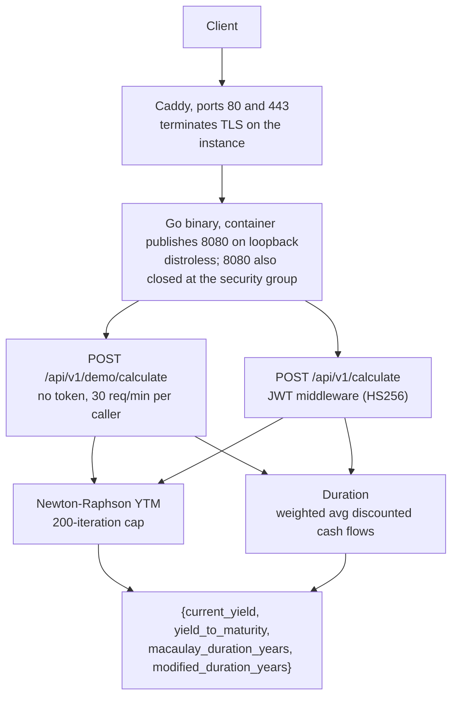

# bondcalc


REST API that computes fixed-income metrics for any bond: yield to maturity via Newton-Raphson, Macaulay and modified duration, and current yield. Written in Go, running on a single EC2 instance behind Caddy. [Try it](https://bondcalc.coreystevens.dev/): the page posts to the same `POST /api/v1/demo/calculate` the curl below does, with no token, capped at 30 requests a minute per caller. `/api/v1/calculate` is the same math behind a bearer token, for a client that has one.

Deploy via Terraform to EC2 (see `infra/`). No ALB and no NAT Gateway: Caddy terminates TLS on the instance itself and reverse-proxies to the Go binary on loopback, so HTTPS costs nothing beyond the instance already running. Spin up locally with `docker compose up`.

## Problem

Bond pricing math is deceptively subtle: YTM has no closed-form solution for most payment schedules, and duration calculations require discounting each cash flow at the solved yield. Finance teams often rely on Excel's YIELD and DURATION functions without understanding the numerical method underneath.

## Solution

A pure-computation Go service. No database, no external dependencies at runtime. YTM solves via Newton-Raphson against a 200-iteration cap, returning an error rather than a wrong answer when it does not converge. Nothing instruments the iteration count, so the only claim the tests back is that a 50,000-period bond still lands inside the cap. Duration computes the weighted average time to each discounted cash flow, normalized to years regardless of payment frequency.

## Architecture



TLS terminates on the instance. Caddy runs with `--network host`, binds 80 and 443, and reverse-proxies to the Go binary on `127.0.0.1:8080`, so no ALB and no ACM certificate are involved. Two independent things keep 8080 private: the container publishes it on `127.0.0.1` only, so nothing off the box can reach it even on the instance's own address, and the security group allows 80 and 443 and nothing else. `curl` to port 8080 from outside gets no connection, and widening a security-group rule by mistake would not change that. The hostname is `bondcalc.coreystevens.dev`, an A record straight to the instance rather than a proxied one, because Caddy answers the ACME challenge itself and a proxy in front of it intercepts that. It first went up on an sslip.io hostname, which resolves any IP embedded in the name and so needs no DNS record at all; that address still works and redirects here.

Two constraints that come with that arrangement. Caddy runs on the host network and dials `127.0.0.1:8080`, which docker-proxy forwards in userland, so the Go process sees the Docker bridge gateway rather than loopback. `internal/api/routes.go` therefore pins `TrustedProxies` to `127.0.0.1`, `::1` and `172.17.0.0/16`; with only loopback listed, gin discarded Caddy's `X-Forwarded-For` and keyed every HTTPS request to that one gateway address, putting all proxied traffic in a single 30/min bucket. That was found by testing the deployed service, not in a unit test, because the test simulated an address the topology does not present. And there is no ACME email configured, so Let's Encrypt cannot send expiry warnings; Caddy renews on its own, and adding an `email` directive in a global block turns the warnings back on.

## Tech Stack

| Layer | Technology | Why |
|---|---|---|
| Language | Go 1.27 | Statically compiled binary, 8.2MB inside an 18.2MB distroless image, no runtime overhead |
| HTTP | Gin 1.10 | Minimal middleware surface, well-understood performance profile |
| Auth | golang-jwt/jwt v5 | HS256 shared-secret JWT, validated in a single middleware layer |
| Build | Multi-stage Dockerfile | Builder compiles; the runtime stage is `distroless/static-debian12`, not scratch, because the binary needs CA certs to reach ECR and SSM over TLS. It also brings tzdata and a nonroot user |
| Infrastructure | AWS EC2 t3.small | Shares one box with five other demos behind the same Caddy; OIDC-based keyless deploys via GitHub Actions + SSM |
| IaC | Terraform 1.9 | GitHub OIDC role, ECR lifecycle policy, S3 remote state |

## Getting Started

```bash
cp .env.example .env
# set JWT_SECRET in .env, 32 characters or more

set -a; source .env; set +a   # nothing in the Go code reads .env
go mod tidy
go run ./cmd/server
```

Or `docker compose up`, which reads `.env` itself and defaults `JWT_SECRET` to a
development value so the demo endpoint works with no setup at all.

Generate a test JWT (requires Go playground or jwt.io with algorithm HS256):

```json
{
  "sub": "test",
  "exp": 9999999999
}
```

Against the live instance, no token needed:

```bash
curl -X POST https://bondcalc.coreystevens.dev/api/v1/demo/calculate \
  -H "Content-Type: application/json" \
  -d '{
    "face_value": 1000,
    "annual_coupon_rate": 0.05,
    "coupons_per_year": 2,
    "periods_remaining": 20,
    "price": 950
  }'
```

The authenticated route takes the same body. Sign a token with your `JWT_SECRET`, then:

```bash
curl -X POST http://localhost:8080/api/v1/calculate \
  -H "Authorization: Bearer <your-token>" \
  -H "Content-Type: application/json" \
  -d '{
    "face_value": 1000,
    "annual_coupon_rate": 0.05,
    "coupons_per_year": 2,
    "periods_remaining": 20,
    "price": 950
  }'
```

Response:

```json
{
  "current_yield": 0.052632,
  "yield_to_maturity": 0.056617,
  "macaulay_duration_years": 7.9273,
  "modified_duration_years": 7.709,
  "coupon_payment": 25
}
```

## Running Tests

```bash
go test -v -race ./...
```

36 tests covering: at-par bonds, discount bonds, premium bonds, zero-coupon bonds, all validation error paths, the relationship invariants (YTM < coupon on premium, Macaulay > Modified), and the demo route's limiter: per-caller isolation, slots returning as they age out, a spoofed `X-Forwarded-For` from an untrusted peer failing to buy a fresh budget, a forwarded address getting its own bucket from both loopback and the docker bridge, which is what the deployed proxy actually presents and what kept every HTTPS visitor in one bucket until it was measured, idle keys being swept so the window map stays bounded, and the demo page: that the root serves HTML, that it names every request and response field the handler binds so a rename on either side cannot break the form silently, and that serving it does not spend the limiter's budget.

## Deploy

See [infra/README.md](infra/README.md) for the full Terraform + EC2 deploy runbook.

Required GitHub secrets: `AWS_ROLE_ARN`, `ECR_API_REPO`, `EC2_INSTANCE_ID`, `PRODUCTION_URL`. The JWT signing secret lives in SSM Parameter Store, not in a GitHub secret; the instance reads it directly at container start.

## Known Limitations

- The YTM solver gives up at the premium extreme, not the discount one. A 5% 10-year bond priced at 100,000 against a face of 1,000 returns `ErrDidNotConverge` rather than a wrong number. Deep discounts are fine: price 1 solves to 50.0 and price 0.01 to 5000. Negative yields are fine too and are returned without an error, so a bond priced above the sum of its remaining cash flows reports the negative yield that implies.
- The API takes `periods_remaining` as a whole number of coupon periods and has no concept of a settlement date, so it can only price a bond standing exactly on a coupon date. There is no accrued interest, no clean-versus-dirty price, and no day-count convention: `30/360` and actual/actual appear nowhere in the code. A bond bought between coupons needs all three, so this is a scope limit rather than a rounding one.
- JWT is HS256 shared-secret: acceptable for a single-service API, not suitable if multiple independent services need to verify tokens (use RS256 asymmetric keys in that case).
- Rate limiting covers the demo route only, and the window lives in process: a second replica would let one caller spend the limit twice over, and a restart forgets every window. The authenticated route is unlimited on the assumption a token holder is not anonymous.
- One instance, no redundancy and no auto-recovery: a single EC2 host serves this and five other demos, so an instance failure is downtime needing manual intervention, and a deploy is a brief gap. An ALB across two instances is the fix, and it is not worth the cost for demo traffic.
- Certificate renewal is unmonitored: Caddy renews on its own and there is no ACME email set, so a failed renewal would surface as a browser warning rather than as an alert.

## License

MIT
